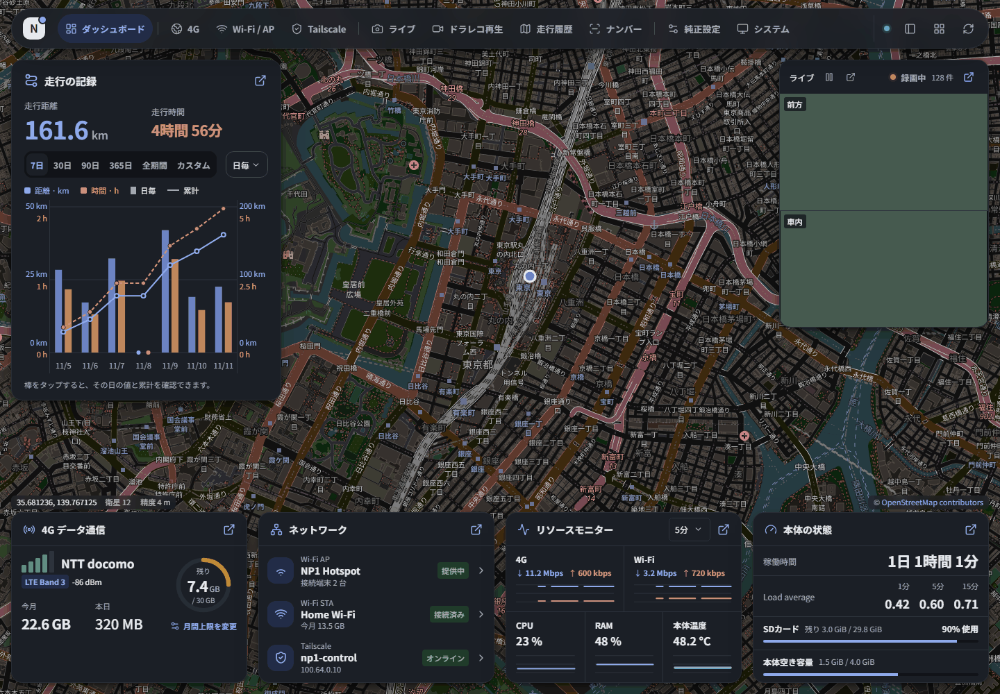
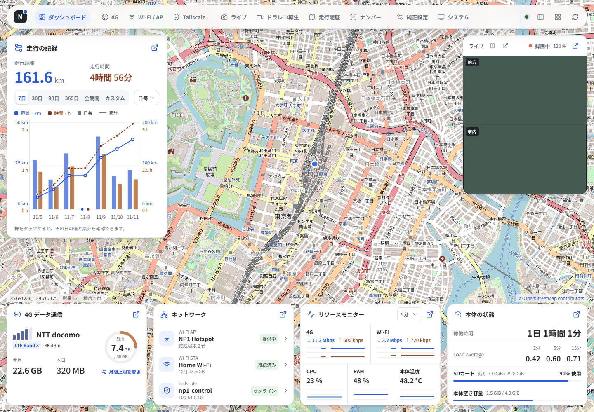

# NP1 Control Center

[変更履歴](docs/releases.md)

Pioneer NP1をブラウザーから管理する、非公式のWebアプリケーションです。走行距離・通信量の確認、ドラレコの再生、Wi-Fiや本体の設定を、PCやスマートフォンから操作できます。

**root ADBで接続できる所有者のNP1向けです。現在は開発版で、対応ファームウェアと機能に制限があります。** 純正アプリ・ファームウェア・ライブラリは同梱していません。





*画面例はすべてサンプルデータです。ライト・ダークテーマに対応しています。PCのメニューは上部と左側から選べ、スマートフォンでは下部に表示します。*

## できること

| 画面 | 主な機能 |
| --- | --- |
| ダッシュボード | 地図を画面いっぱいの背景にして要点を端に配置した「概要」と、すべての情報を並べた「詳細」を切替。走行距離・時間の日別グラフと累計、通信情報の統合表示、現在地・録画状態・軽量ライブ映像、通信速度・CPU・RAM・温度の推移、負荷平均・容量・稼働時間 |
| 4G | キャリア・APN・バンド・電波品質・WAN情報、通信量の確認と上限設定、APNプロファイルの編集・保存 |
| Wi-Fi / AP | Wi-Fi STAの検索・接続・保存、常時テザリングのSSID・認証・DHCP設定、接続端末の確認 |
| Tailscale | 登録・接続状態、アカウントと機器名の表示、機器名の変更 |
| ライブ | SDへ書き込み中のH.264映像を再圧縮せず表示。前方・車内・並べて表示の切替、JPEGプレビュー |
| ドラレコ再生 | カレンダーと時間軸から原本H.264/AACを再生。2カメラ表示、速度変更、走行履歴と地図の時刻連動 |
| 走行履歴 | 距離・時間の集計と走行別の詳細、GPS経路と電波品質の地図、該当時刻の録画への移動 |
| ナンバー | 前方映像から本体内でナンバーを認識し、場所と一緒に記録。一覧と地図の連動、条件（地名・分類番号・ひらがな・番号、`*`指定）に合った車の強調と画像保存、VOICEVOXの声による本体スピーカーでの読み上げ |
| 純正設定 | 純正設定を種類別に1画面へ整理。対応する設定・Alexaウェイクワードを変更 |
| システム | SD・本体情報、LED / 音声、画面の色に連動するLED、純正サービス管理、録画のNASバックアップ、OTA・表示設定 |

走行グラフは7・30・90・365日、全期間、カスタム期間と、日・週・月の集計に対応します。距離と時間を同じグラフで確認できます。位置が取得できなかった区間には、経路や距離を補って表示しません。

## 導入

ホストに **Node.js 24、Go 1.26以降、Python 3、ADB** を用意します。Go 1.27.4でビルドを確認しています。NP1側はAArch64 Linux / systemd環境を前提とし、実機確認済みのファームウェアは **202404231204** です。

```powershell
git clone https://github.com/sochov/NP1_mod.git
cd NP1_mod
powershell -NoProfile -ExecutionPolicy Bypass -File tools/build.ps1
adb devices
python tools/deploy.py --serial SERIAL
python tools/connect.py --serial SERIAL
```

`SERIAL`は接続したNP1のADB識別子に置き換えてください。Linux / macOSではビルドに `sh tools/build.sh` を使います。ビルドには依存パッケージを取得するネット接続が必要です。

ADB転送後は **http://127.0.0.1/**、管理LANからは **http://本体の管理IP/** で開きます。HTTPは80、HTTPSは443です。Webパスワードは設けず、ホットスポットの認証とTailscale側の接続制御を使います。HTTPSは本体で生成する自己署名証明書を使用します。

導入先は `/overlay/owner-apps/np1-control` です。専用のsystemdサービスと起動処理を追加し、**本体の自動アップデートを初期状態で無効化**します。設定画面から再有効化できますが、ファームウェア依存の機能があるため非推奨です。詳細は [導入手順](docs/installation.md) を参照してください。

## 対応範囲

- ライブH.264には、SDカードと稼働中の純正録画サービスが必要です。ライブのマイク音声は未対応です。保存済み録画のAAC音声は再生できます。
- GPSと走行集計は本体の有効な測位データを使います。室内で未測位となる状態を確認しており、屋外実走行での通し検証は未完了です。
- APNは編集・保存まで対応し、通信モデムへの実適用は未対応です。4GとWi-Fi STAを同時に維持した上流の優先切替も未完了です。
- 純正設定と一部の純正サービス操作には、追加ビルドする専用ヘルパーと対応ファームウェアが必要です。公開ソースだけの通常ビルドでは、ヘルパーを必要とする操作は利用できません。
- NASはSMB・SFTP・WebDAVに対応します。実機でのSMB転送・照合・途中再開を確認していますが、本体再起動や経路切断を含む復旧の通し検証は未完了です。自動バックアップは初期状態でOFFです。
- ナンバー認識は開発版です。記録・画像は本体内だけに保存しますが、他の車のナンバーと位置を扱うため、利用と保存の判断は各自で行ってください。精度は別機種のドラレコ映像で評価しており、本体のカメラでの評価は未完了です。読み上げにはWEB版VOICEVOX APIのキー（無料で発行）が必要です。詳細は [ナンバー認識と発話](docs/plate-recognition.md) を参照してください。
- 端末ごとの通信量は取得できない場合があります。長期連続運転やすべてのファームウェアとの互換性を保証する段階にはありません。

## ドキュメント

- [導入・Tailscaleの準備](docs/installation.md)
- [画面の使い方](docs/usage.md)
- [ナンバー認識と発話](docs/plate-recognition.md)
- [更新・復旧・アンインストール](docs/recovery.md)
- [構成とデータの扱い](docs/architecture.md)
- [ネットワークとアクセス制御](docs/security.md)
- [開発・検証](docs/development.md) / [API仕様](docs/api-openapi.yaml)

## ライセンス

独自コードは [MIT License](LICENSE) です。学習済みモデルは [モデル別の条件](models/plate/LICENSING.md) を参照してください。依存するOSSのライセンス本文・著作権表示・NOTICEは [サードパーティライセンス](THIRD_PARTY_LICENSES.md) にまとめています。第三者の純正ソフトウェア、非公開資料、実機の認証情報・録画・位置データは公開対象に含めません。

Pioneer、NP1、Alexa、Tailscaleなどの名称・商標は各権利者に帰属します。本プロジェクトは各社の公式製品ではありません。
