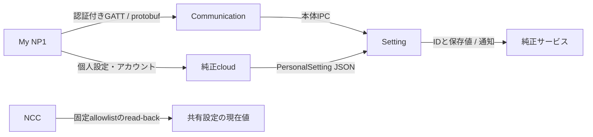

# My NP1設定・通信の照合（2026-11-11）

## 調査した材料

公式Androidアプリは`jp.pioneer.npapp`。メーカー取説から案内される配布先はGoogle Play、iOSはApp Storeである。ローカルのresources/tmpを拡張子APK/AAB/APKS/XAPKで検索したが該当物はなく、Androidアプリ本体のDEX解析を行ったという意味ではない。公式配布ページと取説の画面機能を、所有端末から既に取得しているSetting/Communication ELFの受信側実装・protobuf記述子へ照合した。[公式インストール手順](https://jpn.pioneer/ja/support/manual/np/np-001/usersguide/5759A7DCA83656C6E554C086F1BBD338.php)、[公式Google Play](https://play.google.com/store/apps/details?id=jp.pioneer.npapp)

非公式APK mirrorの取得・実行、スマートフォンの操作、Bluetooth pairing/GATT送信、純正設定のwriteは行っていない。APK本体が得られれば未確定enumやcloud API serializerの静的照合をさらに進められるが、欠けた部分を取説の並び順から数値へ決めつけない。

## NP1 SERVICEに置く項目

公式アプリはサービス選択、目的地、クラウド録画、本体設定、アカウントを別メニューに持つ。NCCでは既存画面と重なる録画/SD、ネットワーク、取付/本体、音量/マイク、LED/USBをここへ重ねない。NP1 SERVICEにはプライバシー、運転サポート、案内/経路の個人設定、コエ替えをまとめる。クラウドの契約・アカウント・過去配信メッセージは、ローカル保存値だけで利用可能と表示しない。[公式アプリの画面構成](https://jpn.pioneer/ja/support/manual/np/np-001/usersguide/5759A7DCA83656C6E554C086F1BBD338.php)

以下は現在のread-only allowlistの18項目。Setting IDと本体受信側の呼出しは既存解析、JSON field/pathと通信分類は今回の追加照合である。JSONは受信payloadの構造であり、そのままWebの公開APIにしたり、cloud要求を再送するための指定ではない。`np1s[対象]`は本体がdevice_noを照合した対象entryを指す。

| Web key / Setting ID | 利用者向けの対象 | 本体受信側で確認した対応 | 変更経路の候補・残課題 |
| --- | --- | --- | --- |
| privacy-mode / 8 | プライバシーモード | PrivacyModeSettingのhard-key toggleと通知 | vendorの同一経路が候補。保存値0/1とON/OFFの意味は未固定 |
| driving-support / 39 | 運転支援の設定 | `navi.driving_support`→SetStatus | PersonalSetting受信JSON。選択肢と保存値の対応待ち |
| guidance-frequency / 44 | 案内頻度 | `navi.guide_frequency`→SetStatus | 同上。別製品COCCHi等のenumを流用しない |
| service-cabin-camera / 49 | 車内カメラのサービス利用許可候補 | `virtual_passenger.allowed_using_in_camera`→SetStatus | 「カメラ案内の頻度」という意味ではない。実際の利用先/反映を追加追跡 |
| tailgating-detection / 50 | 後続車異常接近通知 | TailgatedDetectionRequest field 1 | protobuf command 2。wireと保存値の反転に注意 |
| tailgating-sensitivity / 51 | 後続車検知感度 | TailgatedSensitivityRequest field 1 | protobuf command 3。wire1/2/3→保存0/1/2 |
| traffic-check / 61 | 交通情報の自動確認 | `navi.auto_traffic_check`→SetStatus | PersonalSetting受信JSON、enum未固定 |
| beginner-driver / 62 | 初心者向け案内 | `navi.beginner_driver_mode`→SetStatus | 同上 |
| traffic-congestion / 63 | 渋滞の経路考慮 | `route.traffic_congestion`→SetStatus | 同上 |
| traffic-regulation / 64 | 時間規制の経路考慮 | `route.time_regulation_congestion`→SetStatus | 保存名のまま根拠を保持。取締り/オービス通知と混同しない |
| ferry / 65 | フェリー利用条件 | `route.use_ferry`→SetStatus | PersonalSetting受信JSON、enum未固定 |
| toll-road / 66 | 有料道路の利用条件 | `route.use_toll_road`→SetStatus | 公式取説に機能あり。保存値のON/OFF対応は別検証 |
| smart-ic / 67 | スマートIC利用条件 | `route.use_smart_ic`→SetStatus | PersonalSetting受信JSON、enum未固定 |
| route-search / 68 | ルート探索の優先度 | `route.route_search`→SetStatus | 公式の6選択肢あり。番号との対応は未固定 |
| daily-voice / 77 | **いつものコエ** | `np1s[対象].voice_change.daily`→SetStatus | 通知のON/OFFではなくコエ替え。6種との数値対応は未固定 |
| support-voice / 78 | **安心サポートのコエ** | `np1s[対象].voice_change.safe_secure`→SetStatus | 同上。単なる「安心安全の案内」toggleにしない |
| front-car-start / 79 | 前方車発進通知 | `np1s[対象].drive_support.move_front_car`→SetStatus | 公式は通知方法3択。保存enum対応待ち |
| signal-change / 80 | 青信号通知 | `np1s[対象].drive_support.signal_change`→SetStatus | 同上 |

Web keyは現在の固定allowlistを記した。説明と分類を改善する際、保存値が不明な項目をON/OFF UIへ変換しない。現在のread-backとsetterの実装到達点は[native-settings-compatibility.md](native-settings-compatibility.md)を参照する。

## 取説との照合で分かった修正点

ID77/78は`voice_change`配下である。公式のコエ替えは「いつものコエ」と「安心サポートのコエ」を別々に選ぶ仕様で、選択肢は女性1/女性2/男性1/男性2/悠木碧1/悠木碧2。したがって「日常の案内」「安心安全の案内」を有効/無効にする項目として扱わない。数値の対応はこの一覧順から推測しない。[公式コエ替え手順](https://jpn.pioneer/ja/support/manual/np/np-001/usersguide/A0D3DA9332568C1DD070744452989ABA.php)

ルート優先度は「あなたに合わせる」「おすすめ」「距離が短い」「道が広い」「到着が早い」「料金が安い」の6種類。これは機能選択肢を確認する根拠であり、Setting ID68の整数対応を証明するものではない。[公式ルート優先度](https://jpn.pioneer/ja/support/manual/np/np-001/usersguide/656757A9F2C2ACB139458C7EE0B23EED.php)

前方車発進通知と青信号通知は、効果音と音声/効果音のみ/通知しないの3択。ID79/80を単純なboolにしない。なお取締り通知/オービスの設定は別のサービスであり、`time_regulation_congestion`と同一視しない。[公式サービスカスタマイズ](https://jpn.pioneer/ja/support/manual/np/np-001/usersguide/B5B0132AC5AE41FCEDA56C6AFB5714D4.php)、[公式取締り・オービス設定](https://jpn.pioneer/ja/support/manual/np/np-001/usersguide/B6E7C3E6D26C42236DD42CD8FD77DE70.php)

プライバシーモードは位置公開、イベント等のcloud upload、トピック発話を制限する一方、SD常時録画は続く。録画停止や全ネットワーク遮断として扱わない。公式の本体ボタン操作は確認できるが、保存値の番号対応は別問題である。[公式プライバシーモード](https://jpn.pioneer/ja/support/manual/np/np-001/usersguide/0B8E75E68E7D26E248A6E1D7598C4B06.php)

## 本体側で抽出した通信inventory

`tools/inventory_np1_protocol.py`はELFを実行せず、最大64MiBの入力から名前付きFileDescriptorProto候補を取り出す。各descriptorは最大256KiB、top-level protobuf wire境界と正式parserの両方で検証する。出力はファイルhash、schema名、message/field/enumの構造だけ。実データ、token、PSK、memory dumpは抽出しない。今回の出力はGit除外の`tmp/companion-protocol-inventory.json`。

| 所有済み本体ELF | 抽出schema | 既存画面との関係 |
| --- | --- | --- |
| Setting | TailgatedSetting、VolumeSetting、BeamformingSetting、VirtualPassengerSetting、DriveRecorderSetting、InstallationSetting、InitialSetup、EdgeInfo | 後続車以外の音量/集音/録画/取付は各専用画面へ。InitialSetupの初期化、EdgeInfoのlogin/check-inを通常設定へ混ぜない |
| Communication | Authentication、SwitchingDestinationServer、proto_APmodeAndLTE、proto_STAmode、proto_WiFiCommunicationStandard | 認証/接続管理はネットワーク層。サーバー切替や認証取消を一般設定へ公開しない |
| NEventWatcherCom | この形式のembedded descriptorは未検出 | descriptor不検出を通信機能不在の証明にはしない |

### protobuf/GATTとcloud JSONは別経路



GATTのUUID、署名PDU、既に確認されているfunction/commandは、所有者から提供された非公開の実機開発ガイド第10章にある本体解析情報を根拠とする。原本は公開リポジトリへ含めない。これはメーカーが公開したAPI仕様書という意味ではない。今回13個のschemaにPersonalSetting.protoは含まれておらず、18項目すべてが同じBLE protobuf setterで変更できると仮定しない。

TailgatedSettingはgetter command 1、検知setter 2、感度setter 3、responseはそれぞれ0x8001〜0x8003をschemaで確認した。検知wire enumは1=OFF/2=ONだが、保存値は0=ON/1=OFF。感度もwireと保存値が1ずれる。外側のBLE function ID割付は今回未確定で、他機能の番号から推測してフレームを生成しない。

PersonalSettingは`UpdatePersonalInfo()`がJSONを解析してSetStatusへ渡す別経路。通常clientとしてのAIPI初期化・vendor setter・通知・read-backを確認することが、ローカルWebから適用する候補になる。cloudの`user_key`や対象機器の選別があることは確認したが、credentialを抜き出して要求を偽装したり、共有mapを直接writeしたりはしない。setterの反映試験はAP等の実機試験と分離しroot担当が管理する。

## 再現と未完了

```powershell
python tools/inventory_np1_protocol.py resources/Setting resources/Communication resources/NEventWatcherCom
python -m unittest discover -s tests -p test_protocol_inventory.py -v
```

ホストの解析用Pythonには`protobuf`が必要。runtime/deviceには追加しない。合成descriptorで境界検証、切断/偽候補拒否、連続descriptor分離の3試験が合格した。18項目の現在値読取りや既存vendor helperをこのtoolは変更しない。

この文書の静的inventoryの後、保存ラベルの消費側解析と11項目のvendor setter・永続保存・元値復元をWeb経由でも確認した。現在の対応は `native-setting-values.md` と `native-extended-controls.md` を参照。APKのDEX/serializer照合、残る保存enum、未固定BLE function ID、その他設定の変更試験は継続する。
